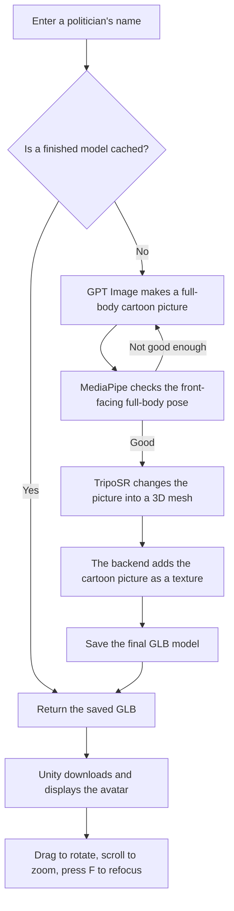

# Meta Avatar Test

This is a small demo for making a full-body 3D cartoon avatar of a public politician.

You type a real politician's name, such as `Olaf Scholz`. The backend first asks GPT Image to make a front-facing cartoon picture. It checks the body pose, sends the picture to an image-to-3D service, adds the picture as a texture, and saves the result as a GLB model. Unity then downloads and shows the model.

## Full Process



## What You Need

- macOS or Windows 10/11
- Python 3.10 or a compatible Python version
- Unity `6000.5.4f1`
- An internet connection
- An OpenAI API key
- Docker Desktop, only if you want to use the container or DUUI version

The image generation API can cost money. The first generation can also take several minutes. A cached model is much faster because it does not need to be generated again.

The current backend uses `gpt-image-2` for the cartoon picture and `stabilityai/TripoSR` for the 3D mesh.

## Quick Start With the GUI

This is the easiest way to run the complete program.

First, close the `Test/frontend_unity` project if it is already open in Unity.

### macOS

Open the `Test` folder and double-click `Start.command`. If macOS blocks it, right-click it and choose **Open**.

You can also use this example path in Terminal. Replace `/path/to` with the place where you saved the project.

```bash
cd /path/to/meta_avatar_llm/Test
./Start.command
```

### Windows

Open PowerShell and use this example path. Replace `C:\path\to` with the place where you saved the project.

```powershell
cd C:\path\to\meta_avatar_llm\Test
py launcher.py
```

If the `py` command is not available, try:

```powershell
python launcher.py
```

### After the Launcher Opens

1. Enter your OpenAI API key.
2. Click **Start Program**.
3. Wait until the backend is ready and Unity opens.
4. In Unity, open `SampleScene` if it is not already open.
5. Press the **Play** button at the top of the Unity window.
6. Enter a real public politician's full name.
7. Click **Generate Full Body**.

When the model is ready:

- Hold the left mouse button and drag to rotate it.
- Use the mouse wheel to zoom in or out.
- Press `F` to put the model back in the centre.

The launcher does not save your API key. Keep the launcher open while using the Unity program. Click **Stop Backend** when you finish.

## Manual Start

Use this method if you want to see the backend logs directly.

### macOS

```bash
cd /path/to/meta_avatar_llm/Test/backend_python
python3 -m venv .venv
source .venv/bin/activate
python -m pip install -r requirements.txt
export OPENAI_API_KEY='your-api-key'
python main.py
```

### Windows PowerShell

```powershell
cd C:\path\to\meta_avatar_llm\Test\backend_python
py -m venv .venv
.venv\Scripts\python.exe -m pip install -r requirements.txt
$env:OPENAI_API_KEY='your-api-key'
.venv\Scripts\python.exe main.py
```

When you see this message, the backend is ready:

```text
Uvicorn running on http://127.0.0.1:8000
```

You can check it in another Terminal window:

```bash
curl http://127.0.0.1:8000/api/health
```

On Windows PowerShell, use:

```powershell
curl.exe http://127.0.0.1:8000/api/health
```

The expected answer is:

```json
{"status":"ok","service":"meta-avatar"}
```

Next, open `Test/frontend_unity` with Unity Hub, open `SampleScene`, and press **Play**.

Press `Control+C` in the backend Terminal when you want to stop it.

## Run With Docker

Docker starts the backend and the DUUI service. It does not open Unity for you.

First, start Docker Desktop.

### macOS

```bash
cd /path/to/meta_avatar_llm/Test
export OPENAI_API_KEY='your-api-key'
docker compose up --build
```

If Terminal says `docker: command not found`, use the Docker Desktop command directly:

```bash
/Applications/Docker.app/Contents/Resources/bin/docker compose up --build
```

### Windows PowerShell

```powershell
cd C:\path\to\meta_avatar_llm\Test
$env:OPENAI_API_KEY='your-api-key'
docker compose up --build
```

The container uses port `8000` on your computer and port `9714` inside Docker. Open Unity separately and use the same backend address:

```text
http://127.0.0.1:8000/api/avatar
```

Stop the container with:

```bash
docker compose down
```

or:

```bash
/Applications/Docker.app/Contents/Resources/bin/docker compose down
```

Docker saves generated models in the `test_meta-avatar-models` volume.

## DUUI Endpoints

The Docker service can also be used as a DUUI component.

| Endpoint | Purpose |
| --- | --- |
| `/v1/typesystem` | Returns the UIMA TypeSystem |
| `/v1/communication_layer` | Returns the Lua communication layer |
| `/v1/documentation` | Shows component information |
| `/v1/details/input_output` | Shows the input and output types |
| `/v1/process` | Creates or loads an avatar |

The DUUI result type is `org.metaavatar.annotation.MetaAvatar3D`.

If the DUUI client runs on another computer, set `META_AVATAR_PUBLIC_BASE_URL` to an address that the other computer can reach. For example:

```text
http://192.0.2.10:8000
```

This is only an example address. Replace it with the real IP address or domain name of your server. You can also use `include_binary=true` to put the GLB and PNG data directly into the CAS.

## Saved Files

When you run the normal Python backend, the files are saved here:

```text
backend_python/hf_generated_models/
```

Each avatar normally has two files:

- `name-ai-cartoon-v1-xxxx.glb` is the 3D model.
- `name-ai-cartoon-v1-xxxx.reference.png` is the generated cartoon picture.

## Common Problems

### Port 8000 is already in use

Another backend or Docker container is already running. Stop it first, then try again.

```bash
lsof -nP -iTCP:8000 -sTCP:LISTEN
```

On Windows PowerShell, use:

```powershell
Get-NetTCPConnection -LocalPort 8000
```

### The API key is missing

The health endpoint can still say `ok`, but a new avatar cannot be generated without `OPENAI_API_KEY`. Add the key in the GUI or export it before starting the backend.

### Generation takes a long time

GPT Image and TripoSR are online services. A new model may take a few minutes. Do not click the generate button many times while one request is still running.

### Unity does not open

Check that Unity `6000.5.4f1` is installed with Unity Hub. Also make sure the same Unity project is not already open in another window. On Windows, the launcher looks for Unity in the normal `C:\Program Files\Unity\Hub\Editor` folder.

### The face is not exactly the same

This program makes a cartoon avatar from one generated front picture. It is not a face scanner, so some facial details will be different from the real person.

### The browser asks for `favicon.ico`

A `404 Not Found` message for `favicon.ico` is harmless. It does not affect the backend.
