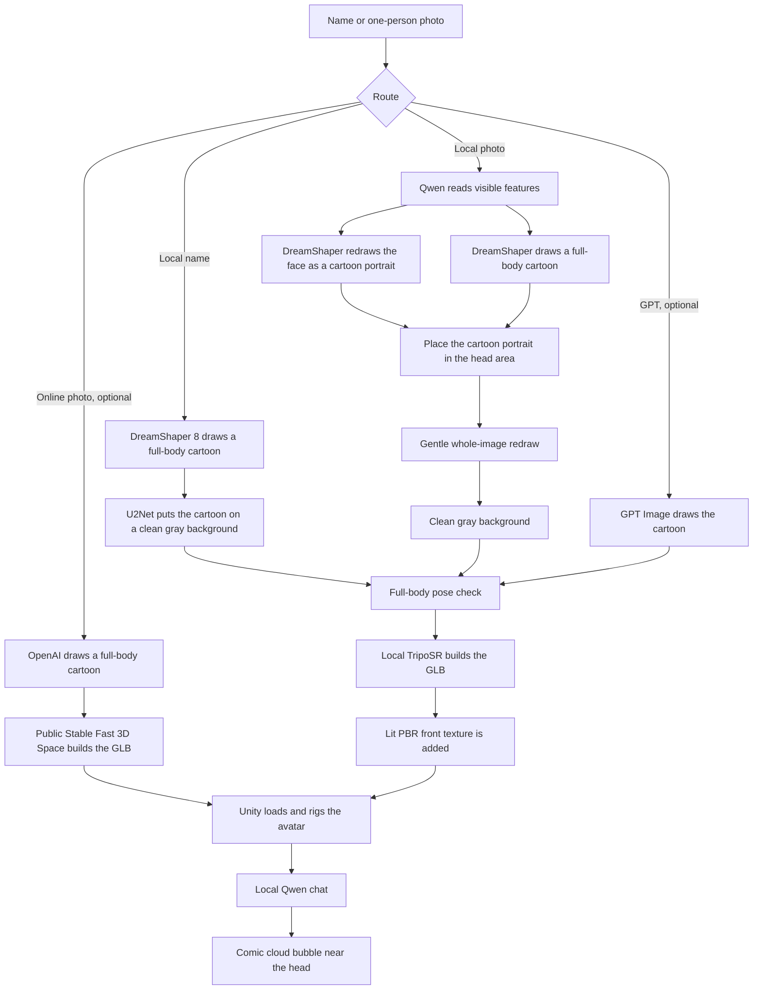

# Meta Avatar

This demo turns a name or a photo into a full-body cartoon, builds a 3D GLB model, and shows it in Unity. It works with the Ollama version already installed on the computer. Ollama runs Qwen for photo reading and chat. The local image route uses DreamShaper 8 with SD 1.5-compatible files to draw the cartoon. The program does not ask Ollama to generate images.

There is also an optional **Online Photo 3D** route: OpenAI redraws one supplied photo as a full-body cartoon, then the public Stability AI Stable Fast 3D Space makes the GLB. This route needs internet and an OpenAI API key, but not the local model weights. It sends the original photo to OpenAI and the cartoon to the public Space; OpenAI use can cost money, and the Space may queue, rate-limit, or be unavailable. A Hugging Face token is optional for that service.

The local photo route accepts one clear portrait, upper-body photo, or full-body photo. It first redraws the source face as a cartoon portrait and makes a separate full-body cartoon. It places the cartoon portrait in the head area and then redraws the whole image gently so the two parts fit together. The original photo is never pasted into the result.

## Flow



| Unity button | What it does | Internet |
| --- | --- | --- |
| GPT Name 3D | GPT Image makes the reference, then local TripoSR builds 3D | yes, API key |
| Local Name 3D | local DreamShaper 8 makes a generic full-body cartoon from the name | no |
| GPT / Local | makes both name models and shows them side by side | GPT needs internet |
| Local Photo 3D | Qwen reads the photo, DreamShaper 8 draws a cartoon portrait and full body, then TripoSR builds 3D | no after setup |
| GPT Photo 3D | GPT edits the photo into a full-body cartoon, then local TripoSR builds 3D | yes, API key |
| Online Photo 3D | OpenAI makes a cartoon, then the public Stable Fast 3D Space builds 3D; no local weights needed | yes, API key and public Space |
| Photo Compare | local result on the left and GPT result on the right | GPT needs internet |
| German MPs | choose some names or generate the list with the local name route | list download needs internet |
| Chat | chat with one avatar or both comparison avatars | no after setup |

The polished Olaf picture is a quality target. The separate portrait step gives the local route more face detail to work with than a short text description alone. It is still an AI redraw, so facial identity, age, hair, clothes, hands, and small details can change. A clear photo normally gives a better likeness than a name.

The quality pipeline uses a lit PBR material and does not draw the same front triangles twice. It also puts a sharpened front projection with a 1536-pixel long side into the GLB. This makes the Unity result clearer, but TripoSR still builds 3D from one view. The back, sides, fingers, hair, and small face details are still estimates.

## Requirements

- macOS on Apple Silicon, or Windows 10/11
- Python 3.10, 3.11, or 3.12
- Unity `6000.5.4f1`
- Ollama, with `qwen3.5:0.8b`
- about 15 GB free disk space for the default models, Python, Unity cache, and generated files; allow about 20 GB if you add the optional face adapter
- 8 GB RAM for the default local route; close other large apps because generation can still be slow or run out of memory
- an OpenAI API key only if you want the GPT or Online Photo 3D buttons

The current Ollama release is fine. There is no need to install an older Ollama version.

## Easy setup and start

### macOS

Open Terminal and use an example project address like this:

```bash
cd /Users/your-name/Projects/6-meta-avatar-llm/Test
python3 launcher.py
```

You can also double-click `Start.command`.

### Windows

Open PowerShell and use an example project address like this:

```powershell
cd C:\Users\your-name\Projects\6-meta-avatar-llm\Test
py -3.12 launcher.py
```

In the launcher:

1. Click **1. Download Core + Quality** once after this update. It creates the Python environment and downloads the core SD 1.5 files, DreamShaper 8, TripoSR, and u2net. The download is about 7 GB in total. Files you already have are kept.
2. Click **2. Prepare Qwen** once. It starts Ollama when needed and pulls `qwen3.5:0.8b`.
3. Add an OpenAI API key only if you want GPT.
4. Click **Start Program**.
5. In Unity, open `SampleScene` and press **Play**.

Keep the launcher open. **Stop Backend** stops the Python server.

For **Online Photo 3D only**, you can skip the local model and Qwen downloads. Enter your OpenAI API key in the launcher, optionally enter a Hugging Face token, and click **Start Program**. The Python packages still need to install on the first run. Without the local weights and Qwen, the name, local photo, GPT Photo 3D, comparison, batch generation, and Chat buttons will not work; use **Online Photo 3D**. The launcher does not save either token.

### Optional face adapter for 16 GB or more

The default local photo route does not load IP-Adapter. If your computer has at least 16 GB RAM, you can try IP-Adapter Plus Face for another face guide. It adds about 2.6 GB of downloads and can use much more memory while generating. On an 8 GB M1, a Plus Face test reached about 8.2 GB and stalled. The optional route has not been proven to match a real face exactly.

On macOS, use the existing Python environment, then start the launcher with the option:

```bash
cd /Users/your-name/Projects/6-meta-avatar-llm/Test/backend_python
.venv/bin/python prepare_local_models.py --face-adapter
cd ..
META_AVATAR_LOCAL_FACE_ADAPTER=plus python3 launcher.py
```

On Windows PowerShell:

```powershell
cd C:\Users\your-name\Projects\6-meta-avatar-llm\Test\backend_python
.venv\Scripts\python.exe prepare_local_models.py --face-adapter
cd ..
$env:META_AVATAR_LOCAL_FACE_ADAPTER='plus'
py -3.12 launcher.py
```

Leave that option unset to use the default photo route again.

## Manual setup

### macOS

```bash
cd /Users/your-name/Projects/6-meta-avatar-llm/Test/backend_python
python3.12 -m venv .venv
source .venv/bin/activate
pip install -r requirements.txt
python prepare_local_models.py
ollama pull qwen3.5:0.8b
python main.py
```

### Windows PowerShell

```powershell
cd C:\Users\your-name\Projects\6-meta-avatar-llm\Test\backend_python
py -3.12 -m venv .venv
.venv\Scripts\Activate.ps1
pip install -r requirements.txt
python prepare_local_models.py
ollama pull qwen3.5:0.8b
python main.py
```

The backend is ready when it prints:

```text
Uvicorn running on http://127.0.0.1:8000
```

OpenAI is optional. Set the key before `python main.py` if needed:

```bash
export OPENAI_API_KEY='your-key-here'
```

```powershell
$env:OPENAI_API_KEY='your-key-here'
```

## Use in Unity

- Click **Show Controls** or **Hide Controls** to open or close the left menu. The Name, Photo, and Scene sections can also be opened separately. The menu closes after a model or scene is loaded, so the avatar has more room.
- Type one name and choose **GPT Name 3D** or **Local Name 3D**.
- For a photo, open **Photo generation**, type the person's name, click **Browse Photo**, and select one PNG, JPG, or WebP file up to 15 MB.
- Choose **Online Photo 3D** only when you intend to send the photo to OpenAI and the generated cartoon to the public Stability AI Space. The cartoon preview and GLB will appear when available. The online service can take a long time or fail because of its queue or free-use limits.
- A portrait or upper-body photo is allowed. Use one person with a clear face. A slight turn or tilt is okay. A strong side view, a covered face, a group photo, or heavy blur may fail.
- The generated cartoon must show one front-facing full body, both hands, and both shoes before 3D starts.
- Local quality generation can take 30 to 60 minutes or longer on an 8 GB M1 and can retry after a failed pose check. Click the button once and keep Unity in Play mode.
- Drag a body part to move it. Drag the background to orbit, scroll to zoom, and press `F` to refocus.
- Open **Scene and actions** and use **Plain Scene**, **Parliament**, **Press Room**, or **Election** to change the scene. **Walk / Stand** switches the motion.

After one avatar or a comparison is loaded, click **Chat**. Type a message and press **Send**. Qwen keeps up to six recent turns. One avatar gives one answer. A comparison gives two answers. The replies appear in comic cloud bubbles that follow the model heads while the camera moves.

The avatars are fictional AI characters. They do not claim to be the real politicians and should not invent personal votes, quotes, promises, or experiences.

## Main API

| Endpoint | Purpose |
| --- | --- |
| `GET /api/health` | backend health check |
| `GET /api/avatar?name=Example&provider=local` | local name to 3D |
| `GET /api/avatar?name=Example&provider=openai` | GPT name to 3D |
| `POST /api/avatar-from-image` | multipart fields: `name`, `image`, `provider=local\|openai\|online`; online requires `X-Meta-Avatar-Intent: generate` |
| `GET /api/compare?name=Example` | GPT and local name models |
| `POST /api/compare-photo` | local and GPT photo models |
| `POST /api/chat` | local Qwen chat for one or two avatars |
| `POST /api/batch` | generate several names |
| `GET /api/german-members` | current Bundestag names |

Old photo provider names `ollama`, `sd`, and `basic` are accepted as aliases for `local`, so older clients do not break.

## Docker and DUUI

Prepare the local models first, and keep Ollama running on the host. Then:

```bash
cd /path/to/6-meta-avatar-llm/Test
docker compose up --build
```

On Windows PowerShell:

```powershell
cd C:\path\to\6-meta-avatar-llm\Test
docker compose up --build
```

The host port is `8000`. The container reaches Qwen through `host.docker.internal`. Unity is not included in the container. Apple Silicon runs this `linux/amd64` image through emulation, so local launcher mode is faster. For Online Photo 3D, pass `OPENAI_API_KEY` and optionally `HF_TOKEN` through the environment. Compose leaves Hugging Face access enabled by default; set `META_AVATAR_OFFLINE=1`, `HF_HUB_OFFLINE=1`, and `TRANSFORMERS_OFFLINE=1` for a strictly offline run. Do not put API keys in this README or commit them to the repository.

DUUI endpoints are `/v1/typesystem`, `/v1/communication_layer`, `/v1/documentation`, `/v1/details/input_output`, and `/v1/process`. DUUI uses the local name route by default.

## Useful settings

| Variable | Default | Meaning |
| --- | --- | --- |
| `OPENAI_API_KEY` | empty | enables GPT buttons |
| `HF_TOKEN` | empty | optional Hugging Face account token for the public online 3D Space |
| `META_AVATAR_LOCAL_MODELS` | `backend_python/local_models` | local model folder |
| `META_AVATAR_LOCAL_IMAGE_DEVICE` | `auto` | SD device, including Apple MPS |
| `META_AVATAR_LOCAL_IMAGE_SIZE` | `512x768` | local 2:3 cartoon size |
| `META_AVATAR_LOCAL_IMAGE_STEPS` | `30` | local DreamShaper 8 step setting |
| `META_AVATAR_LOCAL_PHOTO_STRENGTH` | `0.42` | photo identity and cartoon redraw balance |
| `META_AVATAR_LOCAL_FACE_ADAPTER` | `none` | optional `plus` face guide on computers with at least 16 GB RAM |
| `META_AVATAR_LOCAL_FACE_SCALE` | `0.7` | strength of the optional face guide |
| `META_AVATAR_LOCAL_IMAGE_ATTEMPTS` | `3` | full-body retry count |
| `META_AVATAR_LOCAL_TIMEOUT` | `5400` | maximum seconds for each local model job |
| `META_AVATAR_SAFETY_MARGIN` | `0.02` | small tolerance for borderline local safety scores; `0` is strict |
| `META_AVATAR_LOCAL_3D_DEVICE` | `cpu` | TripoSR device |
| `META_AVATAR_MC_RESOLUTION` | `256` | 3D mesh resolution |
| `META_AVATAR_OLLAMA_TEXT_MODEL` | `qwen3.5:0.8b` | photo reader and chat model |
| `META_AVATAR_OUTPUT_DIR` | `backend_python/hf_generated_models` | PNG and GLB output folder |
| `META_AVATAR_OFFLINE` | `0` | set to `1` to disable Online Photo 3D |
| `HF_HUB_OFFLINE`, `TRANSFORMERS_OFFLINE` | `0` in Docker Compose; `1` in local launcher without an API key | set to `1` for strict local-only model access |

## Common problems

**Port 8000 is already in use.** Stop the old backend in the launcher or press `Ctrl+C` in its terminal.

**Backend request failed (HTTP 0).** The connection ended before a response, often because generation was very slow or Unity Play mode stopped. The Unity timeout is 120 minutes. Click once and wait.

**Qwen cannot be reached.** Open the Ollama app or run `ollama serve`, then run `ollama pull qwen3.5:0.8b`.

**The face is not exactly the person.** The local route redraws the supplied portrait as a cartoon and then makes a whole-body picture. It can improve resemblance, but it does not make an exact copy. Try a sharp, front-facing photo with one visible face, or use GPT Photo 3D for the online alternative.

**The generated reference fails.** The input photo can be cropped, but the generated reference must contain the full body. Try another photo or another generation.

**Online Photo 3D queues or fails.** The public Stable Fast 3D Space may be busy or out of free-use time. The cartoon is retained if 3D generation fails; try again later, or use the local photo route after downloading the local weights. An optional `HF_TOKEN` may increase the account's available free allowance but does not guarantee service.

**Unity does not open.** Install Unity `6000.5.4f1` in Unity Hub, or open `Test/frontend_unity` manually.

Generated PNG and GLB files are stored in `backend_python/hf_generated_models/`. The cache version was changed for this pipeline, so old cached results are not reused.
