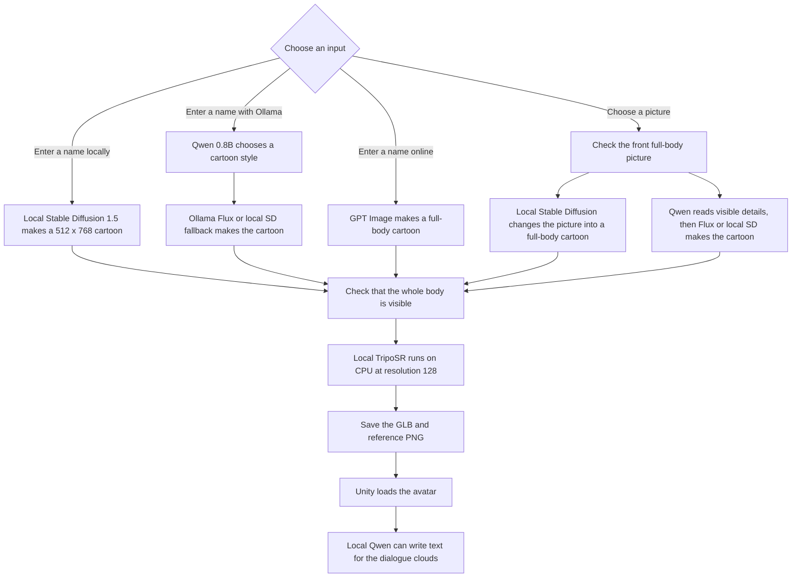

# Meta Avatar Test

This is a small Unity and Python demo for making full-body 3D avatars. It can work fully offline after one online setup.

There are four local input choices:

- Enter a person's name. Stable Diffusion 1.5 makes a cartoon picture on this computer, then TripoSR makes the 3D model.
- Choose your own front full-body picture. Local Stable Diffusion changes it into a cartoon first, then TripoSR makes the 3D model.
- Enter a name with Ollama. A small Qwen model chooses a cartoon style and the program builds the image prompt. Ollama Flux makes the cartoon when enough memory is free. The program uses local Stable Diffusion as a fallback on a small computer.
- Choose a picture with Ollama. Qwen reads the visible face, hair and clothes first. Flux or the local Stable Diffusion fallback then makes the full-body cartoon.

Qwen does not create the PNG by itself. It reads pictures, writes prompts and creates dialogue text. Flux or Stable Diffusion creates the pixels. GPT Image and GPT/Ollama comparison are optional. The Ollama-only buttons work offline after the models are downloaded, but the GPT comparison still needs internet.

## Full Process



Nothing is uploaded when local generation and fully offline mode are used.

## What You Need

- macOS or Windows 10/11
- Python 3.10
- Unity `6000.5.4f1`
- About 20 GB of free disk space for Python packages and all suggested local models
- An internet connection for the first setup only
- Docker Desktop only if you want the Docker or DUUI version

An OpenAI API key is only needed for GPT generation and GPT/Ollama comparison. Ollama is used by the Ollama name and photo buttons, both comparison buttons and automatic dialogue. The suggested models are:

- `qwen3.5:0.8b`, about 1 GB, for reading a picture, writing prompts and dialogue
- `x/flux2-klein:4b`, about 5.7 GB, for experimental local image generation

The local setup downloads these models once:

- `stabilityai/TripoSR` for image-to-3D
- `stable-diffusion-v1-5/stable-diffusion-v1-5` FP16 files for the name-to-cartoon step
- `facebook/dino-vitb16`, which TripoSR needs
- `u2netp` for local background removal

On an 8 GB M1 Mac, 3D generation uses CPU and resolution `128`. Local cartoon generation uses Apple MPS when it is available. Ollama Flux may not fit while Unity and other apps are open. This is why the Ollama path automatically falls back to local Stable Diffusion after Qwen chooses or adds the style details. The program loads the large parts one after another to save memory.

## Quick Start With the GUI

This is the easiest way to run the program.

### macOS

Close the `Test/frontend_unity` project if it is already open. Open the `Test` folder and double-click `Start.command`. If macOS blocks it, right-click it and choose **Open**.

You can also use an example path in Terminal. Replace `/path/to` with the place where you saved the project.

```bash
cd /path/to/meta_avatar_llm/Test
./Start.command
```

### Windows

Open PowerShell and use an example path. Replace `C:\path\to` with your real path.

```powershell
cd C:\path\to\meta_avatar_llm\Test
py launcher.py
```

If `py` is not available, use:

```powershell
python launcher.py
```

### First Online Setup

1. Leave **Fully offline** unticked.
2. Keep the suggested local model folder.
3. Keep 3D resolution at `128` on an 8 GB M1 Mac.
4. Click **Download Local Models**.
5. Wait for `Local models are ready`. Do not close the launcher while files are downloading.
6. Click **Prepare Ollama Models** if you want Ollama name, photo or dialogue generation.

These steps create the Python environment and download the local models. They can take a while. You only need to do them once.

### Start Fully Offline

1. Disconnect the internet if you want to test real offline use.
2. Tick **Fully offline**.
3. Leave the API key empty.
4. Click **Start Program**.
5. Wait until Unity opens.
6. Open `SampleScene` if needed and press the Unity **Play** button.

The launcher also tries to start the local Ollama service. Its models must already have been downloaded with **Prepare Ollama Models** during the first online setup.

For a name:

1. Enter the person's name.
2. Click **Local Name 3D** for Stable Diffusion only, or **Ollama Name 3D** for Qwen plus Flux/SD.
3. The full-body cartoon is made first and is passed to local 3D generation.

For your own picture:

1. Click **Browse** in Unity.
2. Choose a PNG, JPG or WebP file.
3. Enter a simple name for the saved model.
4. Click **Local Photo 3D** for Stable Diffusion only, or **Ollama Photo 3D** for Qwen plus Flux/SD.
5. The photo is changed into a full-body cartoon before local 3D starts.

The picture should show one person looking straight at the camera. The head, both hands, both legs and both feet should be visible. A plain background gives better results.

When the model is ready:

- Hold the left mouse button and drag to rotate it.
- Use the mouse wheel to zoom.
- Press `F` to refocus the camera.
- Use the scene buttons for a plain view, parliament speech, press room or election stage.
- Click **Local / Ollama** for a fully offline split-screen comparison, or **GPT / Ollama** for the online comparison.
- After both comparison models appear, open **Dialogue**, enter a topic and click **Generate with local Qwen**. The two cloud lines stay editable.

Keep the launcher open while using Unity. Click **Stop Backend** when you finish.

## What Works Offline

| Feature | Fully offline |
| --- | --- |
| Local picture to local cartoon to local 3D | Yes |
| Name to local cartoon to local 3D | Yes |
| Ollama Qwen prompt and photo reading | Yes, after the model is pulled |
| Ollama Flux image generation | Yes on supported macOS hardware; local SD is the fallback |
| Qwen dialogue clouds | Yes, after the model is pulled |
| Local/Ollama split-screen comparison | Yes, after the local models are downloaded |
| Load an already saved GLB | Yes |
| GPT Image generation | No |
| GPT/Ollama comparison | No |
| Download a fresh Bundestag member list | No |

A batch with names you already have can still run locally. Opening or updating the official online list needs an internet connection.

## Manual First Setup

Use this if you want to see every command.

### macOS

```bash
cd /path/to/meta_avatar_llm/Test/backend_python
python3 -m venv .venv
source .venv/bin/activate
python -m pip install --upgrade pip setuptools wheel
python -m pip install -r requirements.txt
python prepare_local_models.py
```

### Windows PowerShell

```powershell
cd C:\path\to\meta_avatar_llm\Test\backend_python
py -m venv .venv
.venv\Scripts\python.exe -m pip install --upgrade pip setuptools wheel
.venv\Scripts\python.exe -m pip install -r requirements.txt
.venv\Scripts\python.exe prepare_local_models.py
```

The final line should look like this:

```text
Local models are ready in /example/path/Test/backend_python/local_models
```

The path above is only an example. Your own path will be different.

For the Ollama features, install Ollama. Keep the Ollama app open, or run this in one terminal:

```bash
ollama serve
```

Open a second terminal and download the models once while online:

```bash
ollama pull qwen3.5:0.8b
ollama pull x/flux2-klein:4b
```

If the Ollama app is already running, you do not need a second `ollama serve` process. The launcher button **Prepare Ollama Models** does the same model check and download for you.

## Manual Offline Start

### macOS

```bash
cd /path/to/meta_avatar_llm/Test/backend_python
source .venv/bin/activate
export META_AVATAR_3D_MODE=local
export META_AVATAR_TRIPOSR_PATH="$PWD/local_models/TripoSR"
export META_AVATAR_LOCAL_IMAGE_MODEL="$PWD/local_models/stable-diffusion-v1-5"
export META_AVATAR_LOCAL_3D_DEVICE=cpu
export META_AVATAR_LOCAL_IMAGE_DEVICE=auto
export META_AVATAR_MC_RESOLUTION=128
export META_AVATAR_LOCAL_IMAGE_SIZE=512x768
export META_AVATAR_LOCAL_PHOTO_STRENGTH=0.42
export META_AVATAR_OLLAMA_IMAGE_API_URL=http://127.0.0.1:11434/api/generate
export META_AVATAR_OLLAMA_IMAGE_MODEL=x/flux2-klein:4b
export META_AVATAR_OLLAMA_IMAGE_STEPS=4
export META_AVATAR_OLLAMA_TEXT_API_URL=http://127.0.0.1:11434/api/generate
export META_AVATAR_OLLAMA_TEXT_MODEL=qwen3.5:0.8b
export META_AVATAR_OFFLINE=1
export HF_HOME="$PWD/local_models/.cache"
export U2NET_HOME="$PWD/local_models/u2net"
export HF_HUB_OFFLINE=1
export TRANSFORMERS_OFFLINE=1
python main.py
```

### Windows PowerShell

```powershell
cd C:\path\to\meta_avatar_llm\Test\backend_python
$env:META_AVATAR_3D_MODE='local'
$env:META_AVATAR_TRIPOSR_PATH="$PWD\local_models\TripoSR"
$env:META_AVATAR_LOCAL_IMAGE_MODEL="$PWD\local_models\stable-diffusion-v1-5"
$env:META_AVATAR_LOCAL_3D_DEVICE='cpu'
$env:META_AVATAR_LOCAL_IMAGE_DEVICE='auto'
$env:META_AVATAR_MC_RESOLUTION='128'
$env:META_AVATAR_LOCAL_IMAGE_SIZE='512x768'
$env:META_AVATAR_LOCAL_PHOTO_STRENGTH='0.42'
$env:META_AVATAR_OLLAMA_IMAGE_API_URL='http://127.0.0.1:11434/api/generate'
$env:META_AVATAR_OLLAMA_IMAGE_MODEL='x/flux2-klein:4b'
$env:META_AVATAR_OLLAMA_IMAGE_STEPS='4'
$env:META_AVATAR_OLLAMA_TEXT_API_URL='http://127.0.0.1:11434/api/generate'
$env:META_AVATAR_OLLAMA_TEXT_MODEL='qwen3.5:0.8b'
$env:META_AVATAR_OFFLINE='1'
$env:HF_HOME="$PWD\local_models\.cache"
$env:U2NET_HOME="$PWD\local_models\u2net"
$env:HF_HUB_OFFLINE='1'
$env:TRANSFORMERS_OFFLINE='1'
.venv\Scripts\python.exe main.py
```

Keep the Ollama app or `ollama serve` running when you use an Ollama feature. The backend is ready when you see:

```text
Uvicorn running on http://127.0.0.1:8000
```

Open `Test/frontend_unity` with Unity Hub, open `SampleScene`, and press **Play**. Press `Control+C` in the backend window when you want to stop it.

## API Examples

Check the backend:

```bash
curl http://127.0.0.1:8000/api/health
```

Make a local cartoon and then a local 3D model:

```bash
curl 'http://127.0.0.1:8000/api/avatar?name=Example%20Person&provider=local&force=false'
```

Use local Qwen and Ollama for the name prompt:

```bash
curl 'http://127.0.0.1:8000/api/avatar?name=Example%20Person&provider=ollama&force=false'
```

Upload a local full-body picture:

```bash
curl -X POST 'http://127.0.0.1:8000/api/avatar-from-image' \
  -F 'name=Example Person' \
  -F 'force=false' \
  -F 'provider=local' \
  -F 'image=@/path/to/front-full-body.png'
```

Change `provider=local` to `provider=ollama` to let Qwen read the picture before the cartoon is made.

Generate the two dialogue bubble lines with local Qwen:

```bash
curl 'http://127.0.0.1:8000/api/dialogue?name=Example%20Person&topic=Parliament%20speech'
```

On Windows PowerShell, use `curl.exe` instead of `curl`.

The expected health result is:

```json
{"status":"ok","service":"meta-avatar"}
```

Generated files are saved in:

```text
backend_python/hf_generated_models/
```

## Docker and DUUI

Docker starts the backend and DUUI service. It does not open Unity.

Ollama is not inside this container. Start Ollama on the host computer and pull `qwen3.5:0.8b` and `x/flux2-klein:4b` before using the Ollama buttons or dialogue. Docker Desktop connects to it through `host.docker.internal`.

The Docker image uses Linux x86-64 because the required MediaPipe package has no Linux ARM wheel. On an M1 Mac this runs through emulation, so the normal GUI launcher is better for local generation.

The first Docker build and model download need internet:

```bash
cd /path/to/meta_avatar_llm/Test
mkdir -p backend_python/local_models
docker compose build
docker compose run --rm meta-avatar-duui python prepare_local_models.py --dir /app/local_models
```

After that, start it offline without `--build`:

```bash
META_AVATAR_OFFLINE=1 HF_HUB_OFFLINE=1 docker compose up
```

Windows PowerShell uses:

```powershell
cd C:\path\to\meta_avatar_llm\Test
New-Item -ItemType Directory -Force backend_python\local_models
docker compose build
docker compose run --rm meta-avatar-duui python prepare_local_models.py --dir /app/local_models
$env:META_AVATAR_OFFLINE='1'
$env:HF_HUB_OFFLINE='1'
docker compose up
```

Open Unity separately. The backend address is:

```text
http://127.0.0.1:8000
```

Stop Docker with:

```bash
docker compose down
```

DUUI endpoints:

| Endpoint | Purpose |
| --- | --- |
| `/v1/typesystem` | Returns the UIMA TypeSystem |
| `/v1/communication_layer` | Returns the Lua communication layer |
| `/v1/documentation` | Shows component information |
| `/v1/details/input_output` | Shows the input and output types |
| `/v1/process` | Creates or loads an avatar |

## Common Problems

### Local models are missing

Turn off **Fully offline**, connect the internet and click **Download Local Models**. Do not move only one model subfolder. Keep the complete `local_models` folder together.

### A model download stops

Run the download again. Finished files are reused. Check that there is enough free disk space and that the connection is stable.

### The program runs out of memory

Keep 3D resolution at `128`, generate one avatar at a time, close Ollama and close other large apps. Do not run GPT/Ollama comparison on an 8 GB M1 Mac.

### Generation is slow

TripoSR uses CPU on this Mac, so a new 3D model can take some time. Wait for the current model before clicking another generation button.

### Port 8000 is already in use

Stop the old backend or Docker container first. On macOS:

```bash
lsof -nP -iTCP:8000 -sTCP:LISTEN
```

On Windows PowerShell:

```powershell
Get-NetTCPConnection -LocalPort 8000
```

### A local picture is rejected

Use one clear front full-body picture. Do not use a face-only photo, side view, group photo, image over 15 MB or image over 16 megapixels. The accepted picture is changed into a cartoon before 3D generation.

### The face is different

Typing only a name does not give Stable Diffusion the real face data. A clear reference picture normally keeps the person's look better. Single-image 3D reconstruction is still an approximation, not a face scan.

### Unity does not open

Install Unity `6000.5.4f1` with Unity Hub. Make sure the same project is not already open in another Unity window.

### The browser asks for favicon.ico

A `404 Not Found` message for `favicon.ico` is harmless.
