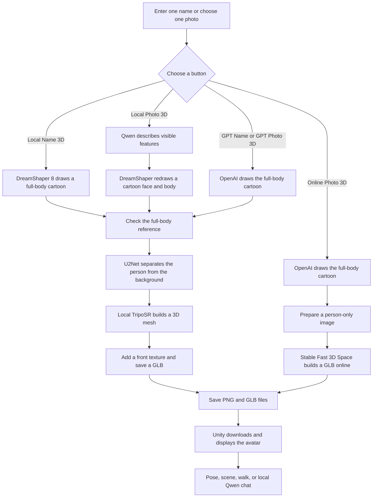

# Meta Avatar — From a Name or Photo to a 3D Character

This README explains the program in the `Test` folder. The program makes a full-body cartoon picture, turns that picture into a 3D model, and shows the model in Unity. You can start with a person's name or with a photo saved on your computer.

It is a demo, not a tool for making an exact digital copy of a real person. A clear photo can help with the face, but the picture model may change details. A single picture also cannot show the back of a person, so the 3D model has to guess what is there.

If you just want to try it, go to [Quick start](#quick-start-with-the-launcher). If you want to know what happens at each step, start with [How the program works](#how-the-program-works).

## Contents

1. [What you can do](#what-you-can-do)
2. [How the program works](#how-the-program-works)
3. [Which button should I choose?](#which-button-should-i-choose)
4. [What is in the Test folder?](#what-is-in-the-test-folder)
5. [What you need before starting](#what-you-need-before-starting)
6. [Quick start with the launcher](#quick-start-with-the-launcher)
7. [Manual setup and start](#manual-setup-and-start)
8. [Using the Unity screen](#using-the-unity-screen)
9. [Generated files, cache, and privacy](#generated-files-cache-and-privacy)
10. [Using the API directly](#using-the-api-directly)
11. [Docker and DUUI](#docker-and-duui)
12. [Useful settings](#useful-settings)
13. [Common problems](#common-problems)
14. [Quality and responsible use](#quality-and-responsible-use)

## What you can do

- Enter one name and make a full-body cartoon avatar.
- Give the program one photo. The photo may show only the face or upper body; the program tries to draw a new full-body cartoon first.
- Choose a local image route or an OpenAI image route. Most routes then use TripoSR on your own computer for the 3D step.
- Use **Online Photo 3D** when you want both image generation and 3D generation to use online services. That route uses OpenAI and the public Stability AI Stable Fast 3D Space.
- Put two results next to each other for comparison.
- Load a list of German MPs, choose a few names, or start a large local batch.
- Change the simple Unity scene, move parts of an avatar, make it walk, and chat with one or two avatars. Chat replies appear in comic-style cloud bubbles.
- Use the Python API without Unity, or run the backend in Docker for DUUI.

The program has three main parts: the Python backend does the AI work, Unity shows the 3D model, and the launcher helps you start both. Ollama runs Qwen for local photo description and chat. **Ollama does not draw the cartoon or create the 3D mesh.**

## How the program works

Here is the main workflow. “Reference image” means the full-body cartoon picture used to build the model.



### The steps in more detail

1. **Choose an input.** A name goes to a name route. A photo route reads one PNG, JPG, JPEG, or WebP file. For a photo, also type a name so the result can be labelled and saved.
2. **Make a full-body cartoon.** Local routes use DreamShaper 8 with Stable Diffusion 1.5 files. The local photo route asks Qwen to describe visible features, makes a cartoon face and body, and redraws them together. GPT routes ask OpenAI to make or edit the cartoon. The original photo is not pasted unchanged onto a 3D head.
3. **Check the generated picture.** The program looks for one person facing roughly forward, with a complete body, hands, and shoes. The source photo may be a headshot, but the *generated reference* must be full-body. For a local photo, Qwen also checks whether important details such as hair length, facial hair, and a necktie changed. If a reference fails a check, some routes try again. A failed check stops the 3D step.
4. **Remove the background.** For local 3D, U2Net keeps the person and removes the floor and background. This matters: if a shadow or the space between the legs is treated as part of the person, the 3D model may have unwanted material there. The online photo route can use the installed local U2Net model for this preparation; if it is not installed, the public 3D Space can remove the background.
5. **Build the 3D shape.** Local routes run the locally stored TripoSR model. It guesses the depth, back, and sides from one picture. The online photo route sends the cartoon to the Stable Fast 3D Space instead. Its queue and limits are outside this program's control.
6. **Add colour and save files.** Local TripoSR results get a front-facing texture from the cartoon image. The output is a `.glb` 3D file, with a matching `.reference.png` image. The online service returns a textured GLB.
7. **Show the result.** The backend gives Unity a URL for the GLB. Unity loads it, fits it into the scene, and adds a simple movable body rig. You can orbit the camera, pose parts, switch scenes, or chat.

For a local job, the heavy image and TripoSR work runs in a separate Python worker process. That worker uses one model job at a time, so two large local jobs do not normally fill memory at the same moment. A comparison can still take a long time because it needs two results.

## Which button should I choose?

| Button in Unity | Cartoon picture | 3D model | What else it needs |
| --- | --- | --- | --- |
| **Local Name 3D** | DreamShaper 8 on your computer | TripoSR on your computer | Downloaded local models; a name alone may not look like the real person |
| **GPT Name 3D** | OpenAI online | TripoSR on your computer | Local 3D models, internet, and an OpenAI API key |
| **GPT / Local** | One OpenAI picture and one local picture | Two local TripoSR models | Both sets of requirements; two results appear side by side |
| **Local Photo 3D** | Qwen describes the photo; DreamShaper 8 draws the cartoon | TripoSR on your computer | Local models and a running Ollama/Qwen service |
| **GPT Photo 3D** | OpenAI edits the supplied photo into a cartoon | TripoSR on your computer | Local 3D models, internet, and an OpenAI API key |
| **Online Photo 3D** | OpenAI edits the supplied photo | Public Stable Fast 3D Space | Internet and an OpenAI API key; a Hugging Face token is optional |
| **Photo Compare** | One local cartoon and one OpenAI cartoon | Two local TripoSR models | Local models, Ollama/Qwen, internet, and an OpenAI API key |
| **German MPs** | Local name route for each selected name | Local TripoSR for each name | Internet to fetch the official list; local models for generation |
| **Chat** | No new image | No new 3D model | A loaded avatar and a running Ollama/Qwen service |

The name alone is only a text hint. If likeness matters, start with a clear photo and inspect the generated cartoon before judging the 3D model. **Local Photo 3D** can run without internet after setup. **GPT Photo 3D** does its image step online but keeps the 3D step local. **Online Photo 3D** is the only button that sends the cartoon to an online 3D service.

The API's `GET /api/avatar` endpoint defaults to the OpenAI name route. When calling it yourself, add `provider=local` if you want the local name route.

## What is in the Test folder?

```text
Test/
├── README.md                         This guide
├── launcher.py                       Small start/stop window
├── Start.command                     macOS double-click starter
├── backend_python/
│   ├── main.py                       API, routes, checks, cache, and 3D flow
│   ├── local_worker.py               Local image, cutout, and TripoSR jobs
│   ├── prepare_local_models.py       One-time model downloader
│   ├── requirements.txt              Python packages
│   ├── duui/                         DUUI type system and Lua connection
│   ├── models/                       Small pose-check file
│   ├── local_models/                 Downloaded model files after setup
│   └── hf_generated_models/          Generated PNG and GLB files by default
├── frontend_unity/
│   ├── assets/Scenes/SampleScene.unity
│   ├── assets/scripts/               Unity interface, camera, rig, and motion
│   ├── Packages/
│   └── ProjectSettings/
├── Dockerfile
├── docker-compose.yml
└── evaluation/                       Optional German MP list check
```

The big files under `local_models/` and the generated files under `hf_generated_models/` are working data, not source code you need to edit. The `evaluation/` folder is for checking the German MP list; it is not required to make an avatar.

## What you need before starting

For the full local workflow:

- macOS on Apple Silicon or Windows 10/11.
- Python 3.10, 3.11, or 3.12. The commands below use Python 3.12 as an example.
- Unity Editor **6000.5.4f1**, the version recorded by this Unity project.
- Ollama and the default `qwen3.5:0.8b` model if you want local photo description or chat. Local Name 3D does not need Qwen.
- Enough free space for Python, model downloads, Unity's cache, and output files. Plan for about 15 GB for the usual local setup; the optional face adapter needs more.
- Enough memory. The basic local route is intended to work on an 8 GB machine, but it can be very slow or run out of memory there. Close other large programs. The optional Plus Face adapter needs at least 16 GB.

For GPT buttons, you also need internet and an OpenAI API key. A Hugging Face token is optional for **Online Photo 3D**. Check your own service access and billing before starting many OpenAI requests, for example through an API batch. The Unity **German MPs** batch uses the local name route.

If you want **Online Photo 3D only**, you can skip the large local model downloads and Ollama. You still need Python and the program's Python packages. The launcher allows this when you enter an OpenAI API key.

## Quick start with the launcher

These are **example paths**, not paths you must copy exactly. Replace `your-name` and the folder address with your own.

### macOS

Open Terminal:

```bash
cd /Users/your-name/Projects/6-meta-avatar-llm/Test
python3 launcher.py
```

You can also double-click `Start.command` in the `Test` folder. It opens the same launcher.

### Windows PowerShell

```powershell
cd C:\Users\your-name\Projects\6-meta-avatar-llm\Test
py -3.12 launcher.py
```

There is no Windows `Start.bat` file; use the PowerShell command above.

### In the launcher window

1. Click **1. Download Core + Quality** for local generation. This creates `backend_python/.venv`, installs Python packages, and downloads Stable Diffusion 1.5 files, DreamShaper 8, U2Net, and TripoSR. The model download is roughly 7 GB. You only need to do this once; existing files are kept.
2. Click **2. Prepare Qwen** if you want local photo generation or chat. This checks Ollama and pulls the model written in the launcher's model field. The default is `qwen3.5:0.8b`.
3. If you want a GPT route, enter your OpenAI API key. The field is hidden on screen and the launcher does not save it. The Hugging Face token field is optional.
4. Click **Start Program**. The launcher checks port 8000, starts the Python backend, waits for its health check, and opens the Unity project. If Unity is already open, it asks you to press **Play** there.
5. Open `SampleScene` in Unity if it is not already open. Press the Unity **Play** button. The input menu appears in the Game view.
6. Keep the launcher open while you use the program. **Stop Backend** stops the server. Closing the launcher also stops a backend that it started.

If you only want the online photo route, enter the OpenAI key and click **Start Program**. You may skip the two model-download buttons, but Python packages still need to be installed. Other generation buttons and local chat will not work without their local models or Qwen.

The launcher may take time on its first run. Watch its log window. Do not press the same generation button many times while one job is still running.

### A quick connection check

When the backend is running, open `http://127.0.0.1:8000/api/health` in a browser. A normal answer looks like this:

```json
{"status":"ok","service":"meta-avatar"}
```

This only proves that the server is running. It does **not** prove that all model files, Ollama, OpenAI, or the public 3D Space are ready. A browser request for `/favicon.ico` may show 404; that does not mean the backend is broken.

## Manual setup and start

Use this section if you do not want the launcher to prepare the backend for you. The model downloader needs internet once. Keep the backend terminal open while Unity is running.

### macOS

```bash
cd /Users/your-name/Projects/6-meta-avatar-llm/Test/backend_python
python3.12 -m venv .venv
source .venv/bin/activate
python -m pip install -r requirements.txt
python prepare_local_models.py
ollama pull qwen3.5:0.8b
python main.py
```

Start the Ollama app before `ollama pull` if it is not already running. If no Ollama service is running, `ollama serve` is another way to start it. Do not start a second `ollama serve` process on the same port.

### Windows PowerShell

```powershell
cd C:\Users\your-name\Projects\6-meta-avatar-llm\Test\backend_python
py -3.12 -m venv .venv
.\.venv\Scripts\python.exe -m pip install -r requirements.txt
.\.venv\Scripts\python.exe prepare_local_models.py
ollama pull qwen3.5:0.8b
.\.venv\Scripts\python.exe main.py
```

Using the Python executable inside `.venv` avoids PowerShell activation-policy problems. Start Ollama first for the photo and chat routes.

The backend normally prints `Uvicorn running on http://127.0.0.1:8000`. Open the Unity project from Unity Hub by selecting the `frontend_unity` folder, open `SampleScene`, and press **Play**. The default Unity backend URL points to `127.0.0.1:8000`.

To stop a manually started backend, press `Ctrl+C` in its terminal. Then start it again after changing Python code or environment settings. If port 8000 is already in use, stop the old server before starting another one.

To use an OpenAI route when starting manually, set the key in the same terminal **before** `python main.py`:

```bash
export OPENAI_API_KEY='your-key-here'
```

```powershell
$env:OPENAI_API_KEY='your-key-here'
```

The examples above are separate macOS and Windows commands. Do not put a real key in this README, source code, or a Git commit.

### Optional Plus Face adapter

The usual local photo route works without IP-Adapter. On a computer with at least 16 GB RAM, you can download and try the optional Plus Face guide:

```bash
cd /Users/your-name/Projects/6-meta-avatar-llm/Test/backend_python
.venv/bin/python prepare_local_models.py --face-adapter
cd ..
META_AVATAR_LOCAL_FACE_ADAPTER=plus python3 launcher.py
```

On Windows PowerShell:

```powershell
cd C:\Users\your-name\Projects\6-meta-avatar-llm\Test\backend_python
.\.venv\Scripts\python.exe prepare_local_models.py --face-adapter
cd ..
$env:META_AVATAR_LOCAL_FACE_ADAPTER='plus'
py -3.12 launcher.py
```

The extra download is about 2.6 GB and the job can use much more memory. It is an extra face guide, not a promise of exact identity. Leave the setting unset to return to the standard route.

## Using the Unity screen

### Open the controls

The controls start open in the Game view. Click **Hide Controls** when you want a larger view of the model, and **Show Controls** to bring the menu back. Open the **Name generation**, **Photo generation**, or **Scene and actions** section you need. After loading a model, the menu closes to leave more space for the avatar; open it again when you need another action.

The input name is used for the avatar label and file cache. For a single name request, enter **one** name. Do not put several names separated by commas into the normal name field.

### Make one avatar from a name

1. Open **Name generation** and type one name.
2. Choose **Local Name 3D** for local DreamShaper plus local TripoSR. Choose **GPT Name 3D** for an OpenAI cartoon plus local TripoSR.
3. Wait for the status message to change. Local generation can take a long time, especially on an 8 GB computer. Keep Unity in Play mode and leave the backend running.
4. To compare the two image routes, use **GPT / Local**. It builds two avatars and opens a split view.

A name does not supply a real face photograph. A result that has the right clothes or age may still have a different face.

### Make one avatar from a photo

1. Open **Photo generation** and type a name.
2. Click **Browse Photo** and choose one image in the Unity Editor. In a built Unity app, paste the image's full path into the photo field instead.
3. Use a PNG, JPG, JPEG, or WebP file no larger than 15 MB. The backend also expects at least 256 pixels on each side and no more than 16 megapixels.
4. Choose **Local Photo 3D**, **GPT Photo 3D**, or **Online Photo 3D**. Use **Photo Compare** to see local and GPT-photo results side by side.
5. Check the saved cartoon reference if the face or clothes look wrong. The 3D step cannot repair a cartoon that already shows the wrong person or a missing body part.

One clear face works best. A headshot or upper-body picture is allowed because the image model draws a new full body. A strong side view, a hidden face, a group photo, or heavy blur may be rejected or may produce a weak likeness. The generated cartoon still needs to show one complete, mostly front-facing person with hands and shoes.

**Online Photo 3D** sends your uploaded photo to OpenAI and sends the generated cartoon to the public 3D Space. Unity adds the required online-generation request header for you. The public service may queue, limit requests, or fail; the cartoon file is kept so you can try the 3D step again later.

### Compare, batch, and change the scene

- **GPT / Local** compares two name routes. **Photo Compare** puts the local-photo result on the left and the GPT-photo result on the right. The split view has two cameras.
- **German MPs** downloads the list for the configured Bundestag electoral period. Search names, tick a few, and click **Generate selected**. **Generate all** asks for confirmation because it can take a very long time.
- The Unity MP batch generates names one after another using the local name route. It saves the GLB files but does not display every finished avatar. **Stop MP Batch** stops after the current name finishes. The backend's separate `/api/batch` endpoint has its own per-request limit.
- **Plain Scene**, **Parliament**, **Press Room**, and **Election** switch between simple Unity scenes. These scene objects are made from basic Unity shapes; the program does not generate a new AI scene mesh for each choice.
- **Walk / Stand** switches a simple walking motion on or off. The automatic rig is based on the model shape. It is not a professional motion-capture rig, so difficult meshes may bend badly.

### Move the camera and chat

- Drag an empty part of the background to orbit around the model.
- Scroll to zoom in or out. Press `F` to focus on the loaded avatar again.
- Drag a body part to pose it. The part moves back toward its resting position. The legs can be controlled separately only if the model shape has a clear split between them.
- Load one avatar or a comparison, then open **Chat**. Type a message and press **Send**. Qwen replies locally. One avatar gives one cloud bubble; a comparison gives two. The bubbles follow the model heads as the camera moves.
- The chat sends up to the six most recent turns as context. It is a short demo conversation, not a record of what a real politician said or believed.

## Generated files, cache, and privacy

By default, results go into `Test/backend_python/hf_generated_models/`. Each finished avatar normally has two matching files:

```text
example-person-...reference.png   The cartoon picture used for 3D
example-person-....glb            The textured 3D model
```

The backend serves those files under `/models/...`. Unity uses the returned `model_url` to load the GLB. `META_AVATAR_OUTPUT_DIR` can move the output folder, and `META_AVATAR_PUBLIC_BASE_URL` can change the URL given to clients.

The file name includes a short hash of the name, route, settings, and, for uploads, the image bytes. If you ask for the same thing again, the backend usually reuses the saved result. Old 3D models without the current quality marker are rebuilt from an existing cartoon reference when possible. That avoids making the same OpenAI cartoon again just to repair the 3D step. Sending `force=true` asks for a new reference **and** a new 3D model; an online image step may then run again.

If an online 3D request fails after the cartoon is ready, the cartoon PNG remains in the output folder. A retry can use it. Do not remove the output folder if you want to keep your cached work.

The local photo route runs its image, background-removal, and 3D steps on your computer. The original upload is read by the backend; this program saves the *generated cartoon* and GLB as its normal result, not a separate copy of the original upload. GPT and Online Photo routes send data to external services. Choose a local route **and keep the Ollama URL pointed at your own computer** if you do not want to send the photo to an external service. Treat generated images and models as personal data when they resemble a real person.

## Using the API directly

The backend also works without Unity. Open `http://127.0.0.1:8000/docs` for the interactive API page while the server is running. The table below lists the main routes.

| Route | What it does |
| --- | --- |
| `GET /api/health` | Checks that the Python server is answering |
| `GET /api/avatar` | Builds one avatar from a name; add `provider=local` or `provider=openai` |
| `POST /api/avatar-from-image` | Uploads one photo with multipart fields `name`, `image`, `provider`, and optional `force` |
| `GET /api/compare` | Builds OpenAI and local name results |
| `POST /api/compare-photo` | Builds local and GPT-photo results |
| `POST /api/batch` | Builds several name results in one request; default limit is 20 names |
| `GET /api/german-members` | Reads the official German MP list, with `start` and `limit` |
| `GET /api/dialogue` | Gets a short Qwen line for one or two avatars |
| `POST /api/chat` | Sends a chat message and recent history to Qwen |
| `GET /models/...` | Downloads a saved PNG or GLB |

One API detail is easy to misunderstand: the `ollama` field in a `/api/compare` result holds the **local DreamShaper avatar**. It is an older field name; Ollama did not make that image. A `/api/compare-photo` result instead uses `left` and `right` for the two avatars.

### Example: check the server

```bash
curl http://127.0.0.1:8000/api/health
```

In Windows PowerShell, use `Invoke-RestMethod http://127.0.0.1:8000/api/health` if you prefer a PowerShell command.

### Example: one local name

```bash
curl -G 'http://127.0.0.1:8000/api/avatar' \
  --data-urlencode 'name=Sample Person' \
  --data-urlencode 'provider=local'
```

This is a real generation request, not just a quick health check. The first run can take a long time. For the GPT name route, use `provider=openai` and set `OPENAI_API_KEY` in the backend environment.

### Example: one local photo

```bash
curl -X POST 'http://127.0.0.1:8000/api/avatar-from-image' \
  -F 'name=Sample Person' \
  -F 'provider=local' \
  -F 'image=@/path/to/person.jpg'
```

On Windows PowerShell, a matching upload can be sent with `curl.exe`:

```powershell
curl.exe -X POST http://127.0.0.1:8000/api/avatar-from-image -F "name=Sample Person" -F "provider=local" -F "image=@C:\photos\person.jpg"
```

For GPT Photo 3D, change the provider to `openai`. For Online Photo 3D, change it to `online` and add the `X-Meta-Avatar-Intent: generate` header:

```bash
curl -X POST 'http://127.0.0.1:8000/api/avatar-from-image' \
  -H 'X-Meta-Avatar-Intent: generate' \
  -F 'name=Sample Person' \
  -F 'provider=online' \
  -F 'image=@/path/to/person.jpg'
```

### Example: chat with one loaded avatar

```bash
curl -X POST 'http://127.0.0.1:8000/api/chat' \
  -H 'Content-Type: application/json' \
  -d '{"message":"Hello! What can you do?","left_name":"Sample Avatar","single":true,"history":[]}'
```

For two avatars, set `single` to `false`, add `right_name`, and pass previous turns in `history`. The backend uses only the latest six turns.

Most generation failures return a JSON answer with `"status":"error"` and a readable `message`, sometimes with HTTP 200. Check the JSON status, not only the HTTP number. Invalid input can return HTTP 422. The online photo route returns HTTP 403 if the intent header is missing. A failed German MP list download can return HTTP 502.

## Docker and DUUI

Docker runs the **Python backend only**. It does not put the Unity Editor in the container. Use Unity separately on your computer and keep its backend URL pointed at `http://127.0.0.1:8000`.

For local routes in Docker, first prepare the model files on the host under `backend_python/local_models/` and keep Ollama running on the host. Then, from the `Test` folder:

```bash
docker compose up --build
```

The same command works in Windows PowerShell. Docker Compose maps host port **8000** to port **9714** inside the container. It mounts local model files read-only and saves generated models in a named Docker volume at `/data/models`. A normal `docker compose down` stops the service; it does not by itself remove that named volume. Do not use `docker compose down -v` if you want to keep generated files.

The container reaches the host's Ollama service through `host.docker.internal`. On Apple Silicon, the Compose file requests `linux/amd64` because of the Python package set; emulation can make local generation much slower than the normal macOS launcher. For **Online Photo 3D only**, the container can start without downloaded local model weights, but it still needs its Python packages, internet, and an OpenAI key.

DUUI uses the same backend. Its routes are `/v1/typesystem`, `/v1/communication_layer`, `/v1/documentation`, `/v1/details/input_output`, and `/v1/process`. The DUUI process route uses **Local Name 3D**: it takes `name`, or falls back to the document's `text`, and can return Base64 PNG/GLB data when `include_binary` is true. A large model makes that response large, so only request binary data when your DUUI workflow needs it. See `backend_python/duui/` for the type system and Lua mapping.

The optional `evaluation/validate_mp_list.py` script checks the German MP list against the official source. It is separate from avatar generation; read `evaluation/MP_LIST.md` before running it.

## Useful settings

Set environment variables **before** starting the backend. The launcher has fields for the OpenAI key, Hugging Face token, Ollama URL, and Qwen model. The table shows the main code defaults; some Compose values are passed separately by `docker-compose.yml`.

| Setting | Default | What it changes |
| --- | --- | --- |
| `OPENAI_API_KEY` | empty | Enables OpenAI image routes; never put a real key in source code |
| `HF_TOKEN` | empty | Optional token for the public Stable Fast 3D Space |
| `META_AVATAR_HOST` / `META_AVATAR_PORT` | `127.0.0.1` / `8000` | Backend listening address and port when run directly |
| `META_AVATAR_LOCAL_MODELS` | `backend_python/local_models` | Folder holding downloaded local model files |
| `META_AVATAR_OUTPUT_DIR` | `backend_python/hf_generated_models` | Folder for PNG and GLB results |
| `META_AVATAR_PUBLIC_BASE_URL` | empty | Public URL prefix returned to Unity or another client |
| `META_AVATAR_LOCAL_IMAGE_DEVICE` | `auto` | Device used for local cartoon generation, including Apple MPS when available |
| `META_AVATAR_LOCAL_3D_DEVICE` | `cpu` | Device used for local TripoSR |
| `META_AVATAR_LOCAL_IMAGE_SIZE` | `512x768` | Size of the local cartoon image |
| `META_AVATAR_LOCAL_IMAGE_STEPS` | `30` | DreamShaper step count; more steps take longer |
| `META_AVATAR_LOCAL_PHOTO_STRENGTH` | `0.42` | How strongly the local photo is redrawn |
| `META_AVATAR_LOCAL_IMAGE_ATTEMPTS` | `3` | Maximum tries for a local cartoon reference |
| `META_AVATAR_LOCAL_FACE_ADAPTER` | `none` | Optional `plus` face guide; uses more memory |
| `META_AVATAR_LOCAL_FACE_SCALE` | `0.7` | Strength of the optional face guide |
| `META_AVATAR_LOCAL_TIMEOUT` | `5400` seconds | Time limit for one local worker job |
| `META_AVATAR_MC_RESOLUTION` | `256` | Local TripoSR mesh extraction resolution |
| `META_AVATAR_FOREGROUND_RATIO` | `0.9` | How large the person is in the 3D model input |
| `META_AVATAR_OLLAMA_TEXT_API_URL` | `http://127.0.0.1:11434/api/generate` | Qwen service address outside Docker |
| `META_AVATAR_OLLAMA_TEXT_MODEL` | `qwen3.5:0.8b` | Qwen model used for photo description and chat |
| `META_AVATAR_UPLOAD_LIMIT_MB` | `15` | Maximum uploaded photo size in the backend |
| `META_AVATAR_OPENAI_IMAGE_MODEL` | `gpt-image-2` | OpenAI image model requested by the backend |
| `META_AVATAR_OPENAI_IMAGE_QUALITY` | `medium` | OpenAI image quality setting |
| `META_AVATAR_HF_3D_WAIT_SECONDS` | `900` | Maximum wait for the public 3D Space |
| `META_AVATAR_BATCH_LIMIT` | `20` | Maximum names in one `/api/batch` request |
| `META_AVATAR_OFFLINE` | unset | Blocks the **Online Photo 3D** API route when set to `1` |
| `HF_HUB_OFFLINE` / `TRANSFORMERS_OFFLINE` | library defaults | Stop Hugging Face model lookups when set to `1`; use after downloads for strict local model access |

Important: `META_AVATAR_OFFLINE=1` is **not** a complete network firewall. It blocks the online-photo route, but it does not automatically stop every GPT name, GPT photo, comparison, or MP-list request. For fully local use, choose local buttons, do not add an OpenAI key, finish model downloads first, and set the Hugging Face offline flags as needed. The local photo and chat routes still need Ollama running on your computer.

## Common problems

**Port 8000 is already in use.** Another backend or container is running. Stop it with **Stop Backend**, `Ctrl+C` in its terminal, or `docker compose down` if Docker started it. Do not start a second server on the same port.

**`/api/health` works, but generation fails.** The health page checks only the web server. Read the backend log for missing model files, an Ollama connection error, an image validation failure, or an online service error.

**“Backend request failed (HTTP 0)” in Unity.** Unity lost its connection before it got a reply. Check that the backend is still running and that port 8000 matches the Unity backend URL. A long local job, a stopped Unity Play session, or a backend crash can all cause this message. Do not click the generation button again until you know whether the first job is still running.

**TripoSR or background model is missing.** Run **1. Download Core + Quality** in the launcher, or run `python prepare_local_models.py` inside `backend_python`. Both TripoSR and U2Net are needed for local 3D.

**Ollama cannot be reached or Qwen is missing.** Open Ollama or start `ollama serve`, then run `ollama pull qwen3.5:0.8b`. Local Name 3D can still work without Qwen, but Local Photo 3D and Chat need it.

**The photo is rejected.** Use one clear face, a supported file type, and a file under the size limit. A headshot is allowed, but a group photo or a face hidden behind an object may fail.

**The generated cartoon is wrong.** Look at its `.reference.png` file. If the cartoon has the wrong face, hair, clothes, pose, missing hands, or missing shoes, the 3D model will carry those problems forward. Try a clearer source photo or a different route. Changing the 3D step alone will not restore details that were never in the cartoon.

**The GLB has rough face, hands, or back.** Local TripoSR and the public online model infer a 3D object from one image. Even with a clean cutout, they may produce uneven surfaces. A more detailed reference can help, but exact likeness and clean unseen surfaces are not guaranteed.

**Online Photo 3D is stuck or unavailable.** The public Space may be waiting for a machine, rate-limited, or temporarily unavailable. The cartoon reference remains saved. Try again later instead of repeatedly asking OpenAI to redraw it. A Hugging Face token may help with access but cannot promise a free or immediate run.

**The Unity Play button shows no input menu.** Open `frontend_unity` as the Unity project, open `SampleScene`, and look at the **Game** view. The controls should start open; if you closed them, click **Show Controls**. If the interface still does not appear, check the Unity Console for script errors.

**You cannot browse for a photo in a built Unity app.** The file picker is available in the Unity Editor. In a built app, paste the full image path into the photo field.

**The German MP list does not load.** The list comes from an external Bundestag ZIP file and is cached in memory for about six hours. Check the internet connection and backend log. A previously generated avatar remains in the output folder even if the list service fails.

**Chat shows no answer.** Load an avatar first and check that Ollama/Qwen is running. Chat is local even when the avatar picture was made with OpenAI.

**Docker is very slow on Apple Silicon.** The Compose file uses an AMD64 image under emulation. Try the normal macOS launcher for local model work. Docker can still be useful for the backend and DUUI workflow.

## Quality and responsible use

This project makes **fictional AI avatars**. A generated model should not be presented as an exact scan or as proof of a real person's appearance, actions, views, votes, or words. The chat prompt is written to avoid pretending that the avatar is the real person. Check the cartoon and GLB yourself before using them in a presentation.

If quality matters, keep the process simple: use one sharp photo, inspect the full-body cartoon, check that the cutout has no floor or shadow attached, and only then judge the 3D result. When a model looks bad, the saved `.reference.png` is the best first place to see whether the problem began in image generation or in 3D reconstruction.
