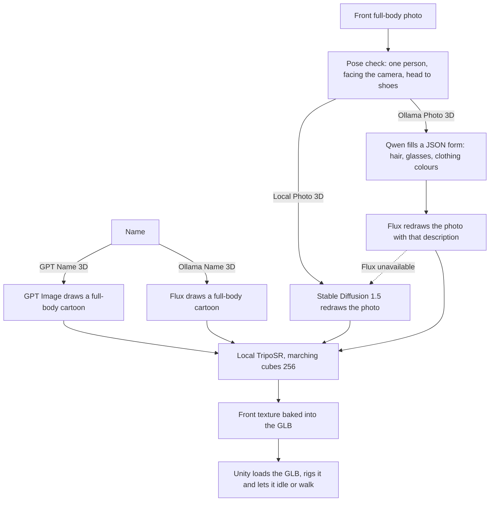

# Meta Avatar

A Unity and Python demo that turns a German member of parliament into a rigged, walking 3D cartoon avatar. The avatar can be made from a **name** or from a **front full-body photo**. Every 3D model is built locally with TripoSR, and Unity adds a skeleton at load time so body parts can be dragged and the avatar can walk.

## Pipelines



| Button | Needs internet | Models |
| --- | --- | --- |
| GPT Name 3D | yes, and an OpenAI API key | gpt-image-2 |
| Ollama Name 3D | no | Flux (x/flux2-klein:4b) |
| Local Photo 3D | no | Stable Diffusion 1.5 img2img |
| Ollama Photo 3D | no | Qwen (qwen3.5:4b) + Flux |
| GPT / Ollama | yes, and an OpenAI API key | GPT Image and Flux side by side |
| Photo Compare | no | Stable Diffusion and Qwen + Flux side by side |
| Dialogue | no | Qwen writes the two speech bubbles |
| German MPs | yes, for the list | official Bundestag open data |

Flux does not know what real politicians look like, so **Ollama Name 3D** draws a generic person with the right clothes. For a likeness, use GPT or a photo.

When a photo is redrawn with **Ollama Photo 3D** and Flux cannot run, local Stable Diffusion makes the cartoon instead and Unity shows a note saying so.

## What You Need

- macOS on Apple Silicon (tested on an M1 Pro with 16 GB) or Windows 10/11
- Python 3.10, 3.11 or 3.12
- Unity `6000.5.4f1` (Unity Hub)
- About 15 GB of free disk space: 5 GB for local models, 9 GB for the Ollama models, the rest for Python packages
- **Ollama 0.32.5** for Flux. Ollama 0.32.6 and newer temporarily removed image generation ([ollama#17893](https://github.com/ollama/ollama/issues/17893)). Qwen still works on newer versions, but Flux then fails and the photo buttons fall back to Stable Diffusion. Do not update Ollama through Homebrew; get 0.32.5 from the [release page](https://github.com/ollama/ollama/releases/tag/v0.32.5).
- An OpenAI API key only for the GPT buttons

## First Setup (once, online)

### With the launcher

macOS: double-click `Start.command`. Windows: `python launcher.py`.

1. Click **1. Download Local Models**. This creates the Python environment, installs the packages and downloads TripoSR, u2net and Stable Diffusion 1.5 into `backend_python/local_models/`.
2. Click **2. Prepare Ollama Models**. This starts Ollama and pulls `qwen3.5:4b` and `x/flux2-klein:4b`. It warns if the installed Ollama is too new for Flux.

### By hand

```bash
cd Test/backend_python
python3.12 -m venv .venv
.venv/bin/pip install -r requirements.txt
.venv/bin/python prepare_local_models.py
ollama pull qwen3.5:4b
ollama pull x/flux2-klein:4b
```

## Start

### With the launcher

1. Optionally paste the OpenAI API key. It is passed to the backend and not saved.
2. Click **Start Program**. The launcher starts Ollama if it is not running, starts the backend and opens the Unity project (or tells you it is already open).
3. In Unity, open `SampleScene` and press **Play**.

Keep the launcher open while you work. **Stop Backend** or closing the window stops the backend.

### By hand

```bash
cd Test/backend_python
export OPENAI_API_KEY='sk-...'          # only for the GPT buttons
export HF_HUB_OFFLINE=1 TRANSFORMERS_OFFLINE=1
.venv/bin/python main.py
```

The backend is ready when `Uvicorn running on http://127.0.0.1:8000` appears.

## Using the Unity Scene

| Row | Controls |
| --- | --- |
| 1 | name field, GPT Name 3D, GPT / Ollama, Ollama Name 3D, German MPs |
| 2 | photo path, Browse, Local Photo 3D, Ollama Photo 3D, Photo Compare |
| 3 | Plain, Parliament, Press Room, Election, Walk, Dialogue |
| 4 | status line |

- Drag a **body part** (head, arm, leg) to turn it. It eases back when released.
- Drag the **background** to orbit, scroll to zoom, press `F` to refocus.
- **Walk** switches between walking on the spot and the idle motion.
- In a comparison, each half of the screen has its own camera. Click **Dialogue** to set a topic, let Qwen write the two speech bubbles, edit them or hide them. The avatars resemble real politicians, so Qwen is told to only welcome the audience and name the topic, never to voice an opinion or a quote.

A photo must show one person facing the camera, head to shoes, arms hanging down, hands and feet visible. A plain background helps. The name used with a photo may only contain letters, spaces, hyphens and apostrophes.

Typical times on an M1 Pro: GPT Name 3D 60 s, Ollama Name 3D 100 s, Local Photo 3D 60 to 85 s, Ollama Photo 3D 105 s, Photo Compare about 3 minutes. The 3D step alone takes about 30 s. Results are cached, so the same name or photo loads in a second the next time.

## Docker and DUUI

The container runs the same backend as a DUUI component. It does not include Unity or the model weights.

1. Run the first setup above so `backend_python/local_models/` exists; docker compose mounts it read-only.
2. Keep Ollama running on the host if you want the Ollama routes; the container reaches it through `host.docker.internal`.
3. Start it:

```bash
cd Test
export OPENAI_API_KEY='sk-...'   # optional
docker compose up --build
```

The service listens on port `8000` of the host (`9714` inside the container). mediapipe only has x86_64 Linux wheels, so the image is `linux/amd64`. On Apple Silicon it runs under emulation and TripoSR is several times slower than with the local launcher; use Docker for DUUI servers and the launcher for the demo.

| Endpoint | Purpose |
| --- | --- |
| `GET /v1/typesystem` | UIMA TypeSystem |
| `GET /v1/communication_layer` | Lua communication layer |
| `GET /v1/documentation` | component information |
| `GET /v1/details/input_output` | input and output types |
| `POST /v1/process` | creates or loads an avatar; result type `org.metaavatar.annotation.MetaAvatar3D` |
| `GET /api/avatar?name=&provider=openai\|ollama` | name to avatar |
| `POST /api/avatar-from-image` (form: `name`, `image`, `provider=local\|ollama`) | photo to avatar |
| `GET /api/compare?name=` | GPT and Flux side by side |
| `POST /api/compare-photo` (form: `name`, `image`) | Stable Diffusion and Qwen + Flux side by side |
| `GET /api/dialogue?topic=` | two speech bubble lines from Qwen |
| `POST /api/batch` | several names one after another |
| `GET /api/german-members` | current MP names from the Bundestag open data |

If the DUUI client runs on another machine, set `META_AVATAR_PUBLIC_BASE_URL` to an address that machine can reach, for example `http://192.0.2.10:8000`. `include_binary=true` puts the GLB and PNG data directly into the CAS.

## Settings

| Variable | Default | Meaning |
| --- | --- | --- |
| `OPENAI_API_KEY` | none | enables the GPT buttons |
| `META_AVATAR_MC_RESOLUTION` | `256` | TripoSR marching cubes resolution. 128 gives about a quarter of the vertices and a visibly coarser avatar |
| `META_AVATAR_LOCAL_MODELS` | `backend_python/local_models` | where the local models live |
| `META_AVATAR_LOCAL_3D_DEVICE` | `cpu` | device for TripoSR |
| `META_AVATAR_LOCAL_IMAGE_DEVICE` | `auto` | device for Stable Diffusion (Apple MPS when available) |
| `META_AVATAR_LOCAL_PHOTO_STRENGTH` | `0.42` | how far Stable Diffusion may move away from the photo |
| `META_AVATAR_OLLAMA_IMAGE_MODEL` | `x/flux2-klein:4b` | Flux model in Ollama |
| `META_AVATAR_OLLAMA_TEXT_MODEL` | `qwen3.5:4b` | Qwen model for reading photos and writing dialogue. `qwen3.5:0.8b` is smaller but got glasses wrong on half of our test photos |
| `META_AVATAR_OUTPUT_DIR` | `backend_python/hf_generated_models` | where GLB and PNG files are saved |

## Saved Files

`backend_python/hf_generated_models/` holds one GLB and one reference PNG per avatar:

- `name-ai-cartoon-v1-xxxx.glb` from GPT, `...-v1-ollama-xxxx.glb` from Flux
- `name-ai-cartoon-v1-photo-xxxx.glb` from Local Photo 3D, `...-photo-ollama-xxxx.glb` from Ollama Photo 3D

Delete a file to force it to be generated again.

## Common Problems

**Port 8000 is already in use.** Another backend is still running. Stop it with **Stop Backend**, `Ctrl+C`, or `lsof -ti :8000 | xargs kill`.

**Ollama Name 3D says this Ollama version cannot generate images.** Install Ollama 0.32.5 (see What You Need). The photo buttons keep working through the Stable Diffusion fallback.

**"Use a photo of one person facing the camera ..."** The pose check rejected the photo. Common reasons: hands in front of the body, arms raised, feet cut off, a landscape picture, or more than one person.

**The avatar looks coarse or blurry.** Check that `META_AVATAR_MC_RESOLUTION` is 256. A good avatar has about 20,000 vertices.

**Unity does not open from the launcher.** Install Unity `6000.5.4f1` in Unity Hub, or open `Test/frontend_unity` yourself.

**The face is not exactly the person.** The image models draw a cartoon, not a portrait. A photo gives a closer result than a name.
