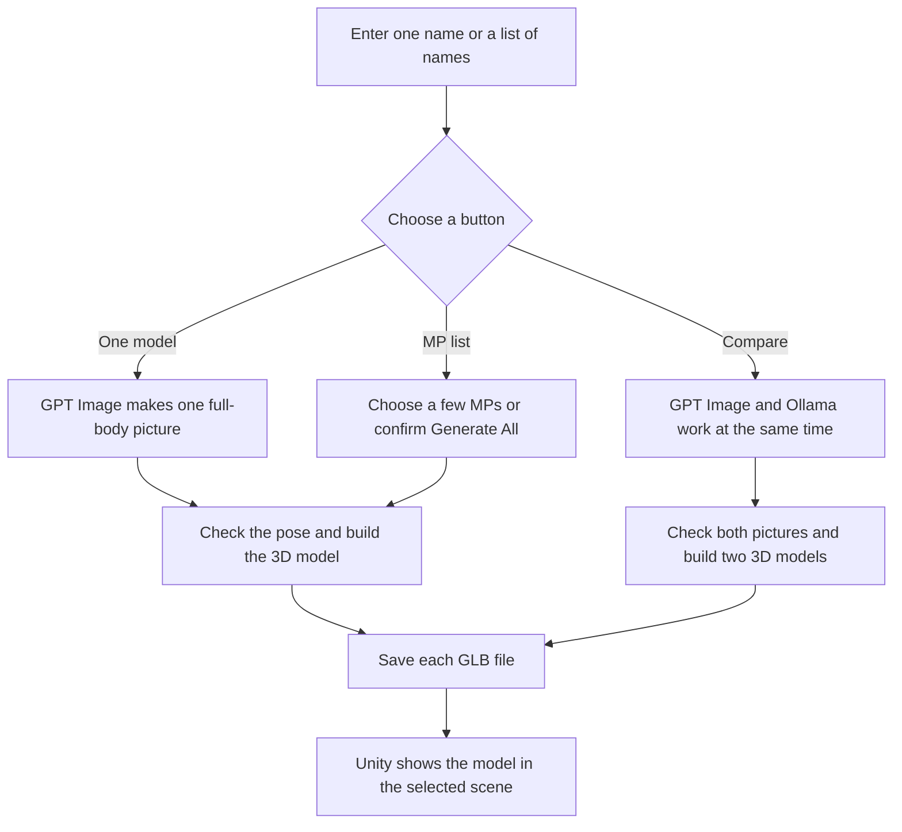

# Meta Avatar Test

This is a small demo for making full-body 3D cartoon avatars of public politicians.

You can make one model, compare two AI image models, or generate German MPs in a batch. You can open the official MP list, search for people, choose a few names, or generate everybody. You can also put the avatar in a plain view, a parliament speech, a press room, or an election stage.

## Full Process



## What You Need

- macOS or Windows 10/11
- Python 3.10 or a compatible Python version
- Unity `6000.5.4f1`
- An internet connection
- An OpenAI API key
- Ollama `0.32.5`, a Mac with enough unified memory, and `x/flux2-klein:4b`, only for the comparison mode
- Docker Desktop, only if you want to use the container or DUUI version

The image generation API can cost money. The first generation can also take several minutes. A cached model is much faster because it does not need to be generated again.

The current backend uses `gpt-image-2` and `x/flux2-klein:4b` for cartoon pictures. It uses `stabilityai/TripoSR` for the 3D mesh.

Ollama image generation is still experimental. Use Ollama `0.32.5`. Newer versions from `0.32.6` temporarily removed image generation, even when the downloaded model still says it can make images. The Ollama image model currently works on macOS. The normal GPT mode and the German MP batch mode can still run on Windows.

Before using comparison mode on macOS, install and start Ollama. Then run this once in Terminal:

```bash
ollama pull x/flux2-klein:4b
```

## Quick Start With the GUI

This is the easiest way to run the complete program.

First, close the `Test/frontend_unity` project if it is already open in Unity.

### macOS

Open the `Test` folder and double-click `Start.command`. If macOS blocks it, right-click it and choose **Open**.

You can also use this example path in Terminal. Replace `/path/to` with the place where you saved the project.

```bash
cd /path/to/meta_avatar_llm/Test
./Start.command
```

### Windows

Open PowerShell and use this example path. Replace `C:\path\to` with the place where you saved the project.

```powershell
cd C:\path\to\meta_avatar_llm\Test
py launcher.py
```

If the `py` command is not available, try:

```powershell
python launcher.py
```

### After the Launcher Opens

1. Enter your OpenAI API key.
2. Keep the normal Ollama URL and model, or change them if your Ollama setup is different.
3. Click **Start Program**.
4. Wait until the backend is ready and Unity opens.
5. In Unity, open `SampleScene` if it is not already open.
6. Press the **Play** button at the top of the Unity window.
7. Enter a real public politician's full name.
8. Choose a generation button and a scene button.

The buttons do this:

- **Generate Full Body** makes one model with GPT Image.
- **Compare GPT / Ollama** makes two versions at the same time. GPT is on the left and Ollama is on the right.
- **Choose German MPs** opens the official Bundestag member list. Search for a name and tick a few people, or click **Select shown**. Then click **Generate selected**.
- **Generate all** prepares every name in the official list. The program asks you to confirm because this can make hundreds of paid image requests and can run for many hours.
- **Stop MP Batch** appears at the bottom-right while a batch is running. It stops after the current person finishes.

The scene buttons are **Plain**, **Parliament Speech**, **Press Room**, and **Election Stage**. You can change the scene before or after loading a model. The scene changes without generating the avatar again.

The batch button saves every successful GLB file in the backend model folder. It does not put hundreds of models into the Unity scene at the same time.

When the model is ready:

- Hold the left mouse button and drag to rotate it.
- Use the mouse wheel to zoom in or out.
- Press `F` to put the model back in the centre.

The launcher does not save your API key. Keep the launcher open while using the Unity program. Click **Stop Backend** when you finish.

## Manual Start

Use this method if you want to see the backend logs directly.

### macOS

```bash
cd /path/to/meta_avatar_llm/Test/backend_python
python3 -m venv .venv
source .venv/bin/activate
python -m pip install -r requirements.txt
export OPENAI_API_KEY='your-api-key'
export META_AVATAR_OLLAMA_IMAGE_API_URL='http://127.0.0.1:11434/api/generate'
export META_AVATAR_OLLAMA_IMAGE_MODEL='x/flux2-klein:4b'
python main.py
```

### Windows PowerShell

```powershell
cd C:\path\to\meta_avatar_llm\Test\backend_python
py -m venv .venv
.venv\Scripts\python.exe -m pip install -r requirements.txt
$env:OPENAI_API_KEY='your-api-key'
$env:META_AVATAR_OLLAMA_IMAGE_API_URL='http://127.0.0.1:11434/api/generate'
$env:META_AVATAR_OLLAMA_IMAGE_MODEL='x/flux2-klein:4b'
.venv\Scripts\python.exe main.py
```

When you see this message, the backend is ready:

```text
Uvicorn running on http://127.0.0.1:8000
```

You can check it in another Terminal window:

```bash
curl http://127.0.0.1:8000/api/health
```

On Windows PowerShell, use:

```powershell
curl.exe http://127.0.0.1:8000/api/health
```

The expected answer is:

```json
{"status":"ok","service":"meta-avatar"}
```

Next, open `Test/frontend_unity` with Unity Hub, open `SampleScene`, and press **Play**.

Press `Control+C` in the backend Terminal when you want to stop it.

## Run With Docker

Docker starts the backend and the DUUI service. It does not open Unity for you.

First, start Docker Desktop.

### macOS

```bash
cd /path/to/meta_avatar_llm/Test
export OPENAI_API_KEY='your-api-key'
docker compose up --build
```

If Terminal says `docker: command not found`, use the Docker Desktop command directly:

```bash
/Applications/Docker.app/Contents/Resources/bin/docker compose up --build
```

### Windows PowerShell

```powershell
cd C:\path\to\meta_avatar_llm\Test
$env:OPENAI_API_KEY='your-api-key'
docker compose up --build
```

The container uses port `8000` on your computer and port `9714` inside Docker. Open Unity separately and use the same backend address:

```text
http://127.0.0.1:8000/api/avatar
```

The Docker setup calls Ollama on the host computer through `host.docker.internal`. Ollama must already be running on the host before comparison mode is used.

Stop the container with:

```bash
docker compose down
```

or:

```bash
/Applications/Docker.app/Contents/Resources/bin/docker compose down
```

Docker saves generated models in the `test_meta-avatar-models` volume.

## DUUI Endpoints

The Docker service can also be used as a DUUI component.

| Endpoint | Purpose |
| --- | --- |
| `/v1/typesystem` | Returns the UIMA TypeSystem |
| `/v1/communication_layer` | Returns the Lua communication layer |
| `/v1/documentation` | Shows component information |
| `/v1/details/input_output` | Shows the input and output types |
| `/v1/process` | Creates or loads an avatar |

The normal web API also has these new endpoints:

| Endpoint | Purpose |
| --- | --- |
| `/api/compare` | Runs GPT Image and Ollama together and returns two GLB URLs |
| `/api/batch` | Generates a JSON list of names one after another |
| `/api/german-members` | Reads the current MP names from the official Bundestag open-data file |

This example returns the first 20 names from the official German Bundestag list:

```bash
curl 'http://127.0.0.1:8000/api/german-members?start=0&limit=20'
```

This example starts a small batch through the backend API:

```bash
curl -X POST 'http://127.0.0.1:8000/api/batch' \
  -H 'Content-Type: application/json' \
  -d '{"names":["Sanae Abdi","Knut Abraham"],"provider":"openai","force":false}'
```

The DUUI result type is `org.metaavatar.annotation.MetaAvatar3D`.

If the DUUI client runs on another computer, set `META_AVATAR_PUBLIC_BASE_URL` to an address that the other computer can reach. For example:

```text
http://192.0.2.10:8000
```

This is only an example address. Replace it with the real IP address or domain name of your server. You can also use `include_binary=true` to put the GLB and PNG data directly into the CAS.

## Saved Files

When you run the normal Python backend, the files are saved here:

```text
backend_python/hf_generated_models/
```

Each avatar normally has two files:

- `name-ai-cartoon-v1-xxxx.glb` is the 3D model.
- `name-ai-cartoon-v1-xxxx.reference.png` is the generated cartoon picture.

## Common Problems

### Port 8000 is already in use

Another backend or Docker container is already running. Stop it first, then try again.

```bash
lsof -nP -iTCP:8000 -sTCP:LISTEN
```

On Windows PowerShell, use:

```powershell
Get-NetTCPConnection -LocalPort 8000
```

### The API key is missing

The health endpoint can still say `ok`, but a new avatar cannot be generated without `OPENAI_API_KEY`. Add the key in the GUI or export it before starting the backend.

### Generation takes a long time

GPT Image and TripoSR are online services. A new model may take a few minutes. Do not click the generate button many times while one request is still running.

A comparison builds two models, so it can take longer. A batch can also take a long time and use paid OpenAI image requests. Start by selecting two or three names. Only use **Generate all** when you understand the time and API cost.

### Ollama comparison does not work

Make sure Ollama is running and the image model has been downloaded:

```bash
ollama pull x/flux2-klein:4b
```

Check the version too:

```bash
ollama --version
```

Use Ollama `0.32.5` for this feature. Ollama `0.32.6` and newer will answer with `image generation models are not currently supported`. The normal launcher URL is `http://127.0.0.1:11434/api/generate`. Ollama image generation is experimental and the listed model currently only works on macOS.

The 4B model is a 5.7 GB download and needs about 5.3 GiB of Metal memory plus Ollama's safety space. An 8 GB M1 Mac may only give Ollama about 4.8 GiB, so comparison mode cannot load this model there. GPT mode still works. Use a Mac with more unified memory or connect the Ollama URL to another Mac that can run the model.

### Unity does not open

Check that Unity `6000.5.4f1` is installed with Unity Hub. Also make sure the same Unity project is not already open in another window. On Windows, the launcher looks for Unity in the normal `C:\Program Files\Unity\Hub\Editor` folder.

### The face is not exactly the same

This program makes a cartoon avatar from one generated front picture. It is not a face scanner, so some facial details will be different from the real person.

### The browser asks for `favicon.ico`

A `404 Not Found` message for `favicon.ico` is harmless. It does not affect the backend.
